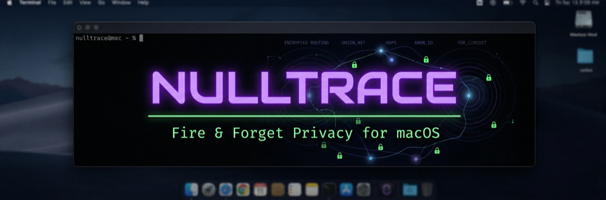

<p align="center">
  
  
  
  
</p>

<p align="center">
  
  
  
  
  
  
</p>

<p align="center">
  
  
  
  
  
  
  
  
  
  
  
  
  
  
</p>

<p align="center">
  
</p>

<p align="center">
  One command. Full privacy. Zero traces.
</p>

---

## What It Does

nulltrace activates a complete privacy stack on macOS with a single command:

```
$ ./nulltrace.sh privacy-on
```

This will:

| Step | Action | Detail |
|------|--------|--------|
| 1 | **MAC Spoofing** | Random unicast MAC on Wi-Fi (persists after privacy-off) |
| 2 | **Hostname Change** | Sets hostname to configurable alias (default: "Lisa") |
| 3 | **Firewall** | Enables macOS ALF firewall + stealth mode |
| 4 | **Tracking Block** | Adds tracking domains to `/etc/hosts` |
| 5 | **Location Services** | Disables `locationd` |
| 6 | **Transparent Tor** | ALL network traffic forced through Tor via `pf` packet filter |
| 7 | **DNS over Tor** | All DNS queries routed through Tor's DNSPort |
| 8 | **IPv6 Block** | IPv6 completely disabled to prevent leaks |
| 9 | **ProxyChains** | Configures for Tor routing |

To restore everything:

```
$ ./nulltrace.sh privacy-off
```

## How Transparent Tor Works

Unlike a simple SOCKS proxy (which only covers apps that respect macOS proxy settings), nulltrace uses **kernel-level packet filtering** to force _every_ TCP connection and DNS query through Tor — no exceptions.

```
┌─────────────────────────────────────────────────────────────┐
│                     macOS Network Stack                      │
│                                                             │
│  Any App ──TCP──► pf route-to lo0 ──► rdr ──► Tor TransPort│
│                                        :9040                │
│  Any App ──DNS──► pf route-to lo0 ──► rdr ──► Tor DNSPort  │
│                                        :9053                │
│                                                             │
│  Tor (_nulltrace_tor) ──► pass out quick (direct to relays) │
│                                                             │
│  Everything else ──► block drop                             │
└─────────────────────────────────────────────────────────────┘
```

### Why a Dedicated User?

Tor needs to connect directly to relay nodes to build circuits. If those connections were also redirected through Tor's TransPort, it would create an infinite routing loop. nulltrace solves this by running Tor as a dedicated system user (`_nulltrace_tor`, UID 399) and using `pf`'s user-based filtering to exempt that user's traffic from redirection:

```pf
# Tor daemon connects directly to relays
pass out quick proto tcp user _nulltrace_tor flags S/SA keep state

# Everything else gets routed through Tor
pass out on $ext_if route-to (lo0 127.0.0.1) proto tcp from any to !127.0.0.0/8
```

This means:
- **Browsers** (Safari, Chrome, Firefox) — all traffic through Tor
- **Terminal apps** (curl, wget, git, ssh) — all traffic through Tor
- **Electron apps** (Slack, Discord, VS Code) — all traffic through Tor
- **System services** (software update, iCloud) — blocked or through Tor
- **DNS queries** — all resolved through Tor (no DNS leaks)
- **IPv6** — completely blocked (no IPv6 leaks)

### Transparent vs Proxy Mode

nulltrace supports two Tor modes, configurable via `TOR_MODE` in `~/.nulltrace/config`:

| | Transparent (default) | Proxy |
|---|---|---|
| **Config value** | `TOR_MODE=transparent` | `TOR_MODE=proxy` |
| **Mechanism** | `pf` packet filter (kernel-level) | macOS system SOCKS proxy |
| **Coverage** | Every app, every connection | Only apps respecting system proxy |
| **DNS** | Through Tor DNSPort | Through configured DNS provider |
| **Leak protection** | Complete (non-Tor traffic blocked) | Partial (apps can bypass proxy) |
| **Requires** | `_nulltrace_tor` user, root | Root for proxy config |
| **Best for** | Maximum privacy | Quick setup, compatibility |

## Quick Start

```bash
# Clone
git clone https://github.com/pepperonas/nulltrace.git
cd nulltrace

# Optional: sudo-free operation (recommended)
./scripts/nulltrace_sudoers_setup.sh

# Go private (transparent Tor — all traffic through Tor)
sudo ./nulltrace.sh privacy-on

# Check status
./nulltrace.sh status

# Restore normal settings
sudo ./nulltrace.sh privacy-off
```

### Shell Aliases (recommended)

Add to your `~/.zshrc` or `~/.bashrc`:

```bash
alias nt='/path/to/nulltrace.sh'
alias nts='/path/to/nulltrace.sh status'
alias nton='sudo /path/to/nulltrace.sh privacy-on'
alias ntoff='sudo /path/to/nulltrace.sh privacy-off'
```

## Usage

### Interactive Mode

```bash
./nulltrace.sh
```

Opens a full TUI menu with numbered options for all features.

### CLI Commands

```bash
# ── Privacy ──────────────────────────────────────────────
./nulltrace.sh privacy-on          # Activate all privacy features
./nulltrace.sh privacy-off         # Restore normal settings
./nulltrace.sh status              # Privacy status dashboard

# ── Tor ──────────────────────────────────────────────────
./nulltrace.sh tor start           # Start Tor service only
./nulltrace.sh tor stop            # Stop Tor service only
./nulltrace.sh tor full-on         # Tor + system-wide SOCKS proxy
./nulltrace.sh tor full-off        # Disable system-wide Tor
./nulltrace.sh tor trans-on        # Transparent Tor routing (pf-based)
./nulltrace.sh tor trans-off       # Disable transparent routing
./nulltrace.sh tor new-identity    # Request new Tor exit node
./nulltrace.sh tor test            # Test Tor connection

# ── Network ──────────────────────────────────────────────
./nulltrace.sh mac                 # Spoof MAC address
./nulltrace.sh ipinfo              # IP & geolocation info (normal + Tor)
./nulltrace.sh killswitch on       # Enable kill-switch
./nulltrace.sh killswitch off      # Disable kill-switch

# ── VPN ──────────────────────────────────────────────────
./nulltrace.sh vpn menu            # Interactive VPN menu
./nulltrace.sh vpn status          # VPN connection status
./nulltrace.sh vpn location        # Current geographic location

# ── Security ─────────────────────────────────────────────
./nulltrace.sh security system     # System security analysis
./nulltrace.sh security network    # Network security scan
./nulltrace.sh security dns        # DNS leak test
./nulltrace.sh security privacy    # Privacy audit
./nulltrace.sh security vuln       # Vulnerability check
./nulltrace.sh security full       # Complete security analysis

# ── Help ─────────────────────────────────────────────────
./nulltrace.sh help                # Show help
```

### Standalone Transparent Tor

You can also use transparent Tor independently of the full privacy suite:

```bash
# Setup (one-time): creates _nulltrace_tor system user
sudo ./scripts/tor_transparent.sh setup

# Start transparent routing
sudo ./scripts/tor_transparent.sh start

# Check status
./scripts/tor_transparent.sh status

# Stop and restore normal networking
sudo ./scripts/tor_transparent.sh stop
```

## Privacy Levels

The status dashboard shows a 5-level privacy score:

| Level | Bar | Condition |
|-------|-----|-----------|
| **MAXIMUM** | `⬛⬛⬛⬛⬛` | Tor active + all protections enabled |
| **HIGH** | `⬛⬛⬛⬛⬜` | Tor active + most protections |
| **MEDIUM** | `⬛⬛⬛⬜⬜` | Tor active + some protections |
| **LOW** | `⬛⬛⬜⬜⬜` | No Tor, but firewall/DNS active |
| **MINIMAL** | `⬛⬜⬜⬜⬜` | Only basic protections |
| **NONE** | `⬜⬜⬜⬜⬜` | No protections active |

## Configuration

Settings are stored in `~/.nulltrace/config`:

```ini
# ── Tor ──────────────────────────────────────────────────
TOR_MODE="transparent"           # transparent (pf-based, all traffic) or proxy (SOCKS only)
TOR_SOCKS_PORT="9050"           # Tor SOCKS5 port
TOR_TRANS_PORT="9040"           # Tor TransPort (transparent mode only)
TOR_DNS_PORT="9053"             # Tor DNSPort (transparent mode only)

# ── Network ──────────────────────────────────────────────
DNS_PROVIDER="cloudflare"        # cloudflare, quad9, custom (proxy mode only)
CUSTOM_DNS_1="1.1.1.1"          # Custom primary DNS
CUSTOM_DNS_2="1.0.0.1"          # Custom secondary DNS
WIFI_INTERFACE=""               # Auto-detect if empty
DISABLE_IPV6="true"             # Disable IPv6 in privacy mode

# ── Privacy ──────────────────────────────────────────────
PRIVACY_HOSTNAME="Lisa"          # Hostname during privacy mode
KILLSWITCH_ENABLED="false"       # Auto-enable kill-switch (proxy mode)

# ── System ───────────────────────────────────────────────
LOG_LEVEL="info"                # debug, info, warn, error
```

### Key Config: `TOR_MODE`

| Value | Behavior |
|-------|----------|
| `transparent` | (Default) Creates `_nulltrace_tor` user, runs Tor as that user, applies `pf` rules to redirect ALL TCP/DNS through Tor. Non-Tor traffic is blocked. DNS goes through Tor's DNSPort. |
| `proxy` | Sets macOS system SOCKS proxy to Tor. Only apps that respect system proxy settings use Tor. DNS goes through configured provider (Cloudflare/Quad9). Legacy mode for compatibility. |

## VPN Support

Multi-provider VPN with geographic server selection:

| Provider | Status |
|----------|--------|
| NordVPN | Supported |
| ExpressVPN | Supported |
| Mullvad | Supported |
| Surfshark | Supported |
| ProtonVPN | Supported |

Advanced chaining modes:
- **Tor-over-VPN** — VPN first, then Tor (hides Tor usage from ISP)
- **VPN-over-Tor** — Tor first, then VPN (hides VPN destination)

## Architecture

```
nulltrace.sh                        Main entry point (interactive menu + CLI)
│
├── scripts/
│   ├── lib/
│   │   ├── utils.sh                Shared library: colors, config, secure_curl,
│   │   │                           Wi-Fi interface/service auto-detection, logging,
│   │   │                           input validation, migration, temp file mgmt
│   │   └── killswitch.sh           pfctl kill-switch + background connection monitor
│   │
│   ├── tor_control.sh              Tor service: start/stop, SOCKS proxy, new identity
│   ├── tor_transparent.sh          Transparent Tor: _nulltrace_tor user, pf rules,
│   │                               TransPort/DNSPort config, full traffic redirect
│   ├── mac_spoofer.sh              MAC address randomization (permanent across sessions)
│   ├── vpn_control.sh              Multi-provider VPN: connect, geo-select, chaining
│   ├── proxychains_setup.sh        ProxyChains-ng config + shell aliases
│   ├── security_tools.sh           Security audit: system, network, DNS, privacy, vuln
│   ├── privacy_enhance.sh          Extended privacy: hostname, DNS, tracking, location
│   ├── sudo_cache_helper.sh        Sudo credential caching with stale lock detection
│   └── nulltrace_sudoers_setup.sh  Sudoers file install (passwordless operation)
│
├── ~/.nulltrace/
│   ├── config                      User configuration
│   ├── runtime/                    PID files, pf rules, torrc (mode 700)
│   └── original_hostname           Backup of original hostname
│
└── /var/lib/nulltrace-tor/         Tor data directory (owned by _nulltrace_tor)
    └── tor.log                     Tor daemon log
```

### Transparent Tor Data Flow

```
privacy-on (transparent mode):
                                                        
  ❶ MAC spoof ──► random unicast MAC on Wi-Fi           
  ❷ Hostname ──► scutil --set * "Lisa"                  
  ❸ Firewall ──► ALF on + stealth mode                  
  ❹ Tracking ──► /etc/hosts block list                  
  ❺ Location ──► launchctl unload locationd              
  ❻ Tor start ──► sudo -u _nulltrace_tor tor             
     │            TransPort 127.0.0.1:9040               
     │            DNSPort   127.0.0.1:9053               
     │            SocksPort 127.0.0.1:9050               
  ❼ pf rules ──► rdr on lo0 → TransPort (TCP)           
     │            rdr on lo0 → DNSPort (UDP 53)          
     │            pass out user _nulltrace_tor (Tor relays)
     │            route-to lo0 all outgoing TCP/DNS      
     │            block drop all (everything else)       
     │            block inet6 all (no IPv6)              
  ❽ ProxyChains config                                   
                                                        
privacy-off:
                                                        
  ❶ pf disable + restore previous rules                 
  ❷ Kill Tor daemon (_nulltrace_tor)                    
  ❸ Restore IPv6, DNS, hostname                         
  ❹ Remove tracking blocks                               
  ❺ Clean runtime files                                  
```

## Requirements

| Dependency | Install | Required |
|-----------|---------|----------|
| macOS 13+ | — | Yes |
| Homebrew | [brew.sh](https://brew.sh) | Yes |
| Tor | `brew install tor` | Yes |
| jq | `brew install jq` | Yes |
| ProxyChains | `brew install proxychains-ng` | Yes |

Missing dependencies are detected on startup with an option to auto-install.

### Transparent Mode Additional Requirements

The transparent Tor mode automatically handles these during first run:

- **`_nulltrace_tor` system user** — Created via `dscl` (UID 399, hidden from login screen)
- **`/var/lib/nulltrace-tor/`** — Tor data directory owned by `_nulltrace_tor`
- **Root access** — Required for `pf` rules and running Tor as system user

Run `sudo ./scripts/tor_transparent.sh setup` to pre-create the user and directories.

## Security Design

- **Zero traffic leaks** — In transparent mode, `pf` blocks all traffic that doesn't go through Tor. There is no path for packets to bypass the proxy.
- **User-based loop prevention** — Tor runs as `_nulltrace_tor`; `pf` exempts only that user's traffic from redirection, preventing infinite routing loops without fragile port-based allowlists.
- **HTTPS only** — All external API calls use `secure_curl()` which rejects HTTP.
- **Secure temp files** — `mktemp` in `~/.nulltrace/runtime/` (mode 700).
- **IPv6 leak protection** — Completely blocked in `pf` rules + `networksetup -setv6off`.
- **DNS leak protection** — All DNS queries redirected to Tor's DNSPort via `pf` NAT rules.
- **Input validation** — Shell metacharacter filtering on all user input.
- **Country code validation** — Strict format check for VPN geo-selection.
- **No hardcoded paths** — Auto-detection for Homebrew prefix, Wi-Fi interface, services.
- **Stale lock detection** — Sudo cache helper cleans up orphaned locks.
- **Atomic pf updates** — Previous pf state backed up and restored on privacy-off.

## Troubleshooting

### Transparent Tor won't start

```bash
# Check Tor log
cat /var/lib/nulltrace-tor/tor.log

# Verify _nulltrace_tor user exists
id _nulltrace_tor

# Re-run setup
sudo ./scripts/tor_transparent.sh setup
```

### Internet not working after privacy-off

```bash
# Manually disable pf
sudo pfctl -d

# Reset DNS
networksetup -setdnsservers Wi-Fi "Empty"

# Re-enable IPv6
networksetup -setv6automatic Wi-Fi
```

### Check if traffic goes through Tor

```bash
# Should show IsTor: true
curl https://check.torproject.org/api/ip

# Check pf status
sudo pfctl -s rules
sudo pfctl -s nat
```

### Switch to proxy mode (if transparent causes issues)

Add to `~/.nulltrace/config`:
```ini
TOR_MODE=proxy
```

This uses the legacy SOCKS proxy approach instead of pf-based transparent routing.

## License

MIT License — (c) 2025 Martin Pfeffer
